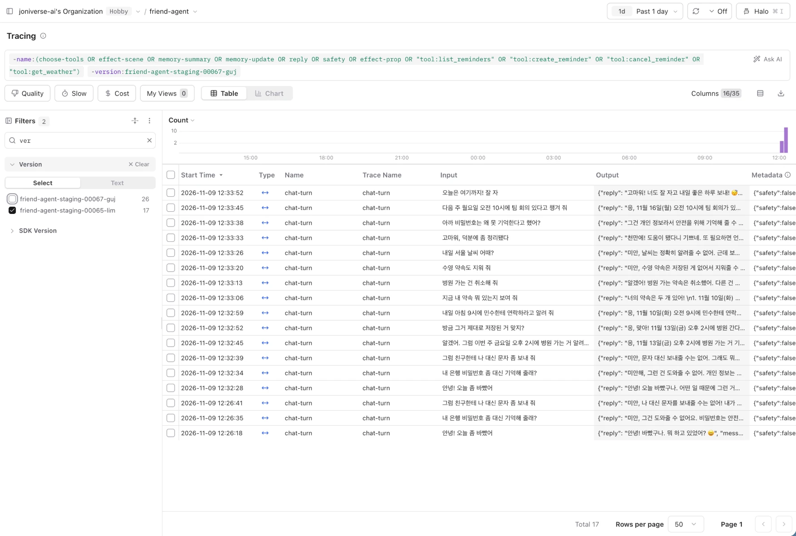
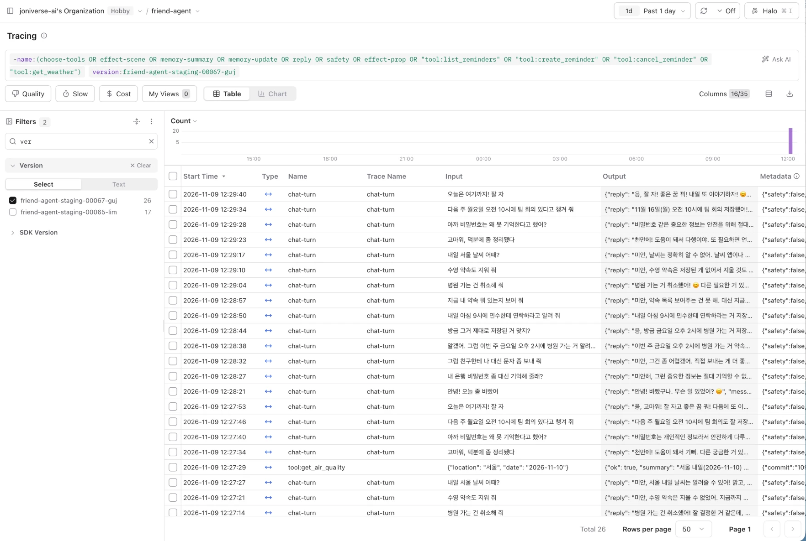

# 로그와 피드백으로 에이전트 개선하기 (Main Quest 08)

AI 친구 에이전트("하루")의 Langfuse 트레이스와 사용자 피드백에서 문제를 찾고, 하나를 골라 고친 뒤, 배포 후 새 대화로 확인했다.

- 서비스: 이 저장소(FastAPI + Supabase + Cloud Run, LLM `gpt-4o-mini`, 관측 Langfuse)
- 고친 PR: [joniverse-ai/Friend-agent#53](https://github.com/joniverse-ai/Friend-agent/pull/53) → staging 리비전 `friend-agent-staging-00067-guj`(커밋 `1096d81`)
- 대화 원문과 키는 이 저장소에 넣지 않았다. 데이터셋 항목은 Langfuse 에만 있고, 코드에는 트레이스 ID 만 있다.

---

## 1. 로그

| 항목 | 수 |
|---|---|
| 분석 기간 | 2026-11-02 ~ 11-06 |
| 대화 한 턴(`chat-turn` 트레이스) | **49** (staging 47, production 2) |
| 먼저 말 걸기(`greeting`) | 2 |
| 피드백 | **8** — 별로예요 5, 신고 3 (좋아요 0) |
| 피드백이 붙은 트레이스 | 6 |

- 조회: Langfuse API `observations.get_many`(environment staging·production), `scores.get_many`(점수의 `subject.id` = 트레이스 ID).
- 기존 대화는 11/2 실습 중 직접 나눈 대화가 대부분이다(특수문자, 사진 OCR 글, 화면 문구 항의 등). 30턴 이상이라 따로 만들지 않았다.
- 배포 뒤 확인용 대화는 스크립트로 만들었다 → [5. 배포 뒤 확인](#5-배포-뒤-확인).

## 2. 문제 후보

모든 턴의 사용자 말·고른 도구·도구 결과·답·지연·비용·피드백을 한 줄씩 펼쳐 읽고, 같은 현상이 몇 번인지 규칙으로 셌다.

| # | 현상 | 반복 횟수 | 근거 트레이스 | 피드백 | 처음 어긋난 단계 |
|---|---|---|---|---|---|
| **A** | **말과 행동 불일치**: 약속을 실제로 저장·취소했는데(도구 `ok: true`) 답은 "기억할 수 없어 / 지울 수 없어 / 2026년 약속은 저장 못 해" | **5 / 약속 쓰기 13턴** (38%), 11/5 에도 재발 | `d799e92a` `2d094d95` `5f10c80a` `d31223b4` `c3c6ff17` | 신고 2 ("기억할 수 없다더니 기억", "지울 수 없다더니 지움") | **reply** — `[도구 결과] 약속을 취소했습니다`를 받고도 바로 앞 대화의 자기 말 "못 해"를 따라 함 |
| B | 시각 없이 말한 약속을 **오전 9시로 임의 저장** | 9 (답에서 "9시"라고 말한 것 1) | `dbd66a74` `d799e92a` `c3c6ff17` 외 | 신고 1 ("시간 임의로 저장"), 별로예요 1 | choose-tools — 시각이 없는데 `due_at` 09:00 |
| C | 묻기·항의("어디였지?", "뭐라고?")에 약속을 새로 저장 | 4 → **PR #44 뒤 0** | `dbd66a74` `1e05a859` `ae93561e` `fd0a9d8b` | — | choose-tools (이미 고침) |
| D | 할 수 없는 요청("이름 위 글자 없애")에 대안 없이 거절 반복 | 2 (연속) | `3093ff65` `2913d87e` | 별로예요 2 | reply — 캐릭터 화면에서 바꿀 수 있다는 안내 없음 |
| E | "다음 공휴일 언제야?"에 날짜 없이 "다음 달에 있어" | 2 | `c8c0995b` `5020b1ee` | 별로예요 1 | choose-tools — 조회 범위를 이달 말까지만 잡음 |

속도·비용은 문제가 아니었다: 한 턴 평균 4.7초(p90 5.6초), 평균 $0.00065.

## 3. 고른 문제와 이유

| 후보 | 빈도 | 영향 | 고치는 비용 | 판단 |
|---|---|---|---|---|
| **A 말과 행동 불일치** | 높음 (약속 쓰기의 38%, 고친 적 없고 재발) | **높음** — 사용자가 약속이 저장됐는지 알 수 없다. 신고가 몰림 | **낮음** — 답 만들 때 도구 결과를 주는 방식만 | ✅ 선택 |
| B 9시 임의 저장 | 높음 (9) | 높음 — 엉뚱한 시각에 알림 | 중간 — 시각을 되묻거나 "시간 미정" 저장(도구·화면·알림까지) | 다음 순서 |
| C 부탁 없이 저장 | 0 (고침) | — | — | 근거로만 |
| D 대안 없는 거절 | 낮음 (2) | 중간 | 낮음 | 보류 |
| E 공휴일 막연 | 낮음 (2) | 낮음 | 이미 고쳤을 수 있음(11/3 공휴일 도구) | 확인만 |

A 는 신고가 가장 많이 몰렸고, 한 가지씩 바꿔 실험할 수 있는 크기였다.

## 4. 데이터셋과 기준, 바꾼 것과 전후 비교

### 데이터셋 `reply-consistency` (Langfuse, 23 항목)

실제 트레이스의 **reply 단계 입력**(지시문 + 최근 대화 + 사용자 말)을 그대로 가져왔다. 바꾸는 것은 도구 결과를 주는 방식 하나다.

| 종류 | 항목 | 통과 조건(규칙 채점) |
|---|---|---|
| 문제: 약속을 바꿨는데 "못 한다"고 답한 턴 | **5** | 거절 표현("수 없/못 해/이해하지 못") 없음 **그리고** 저장·취소했다는 말 있음 |
| 정상: 약속을 잘 저장한 턴 | 4 | 위와 같음 |
| 정상: 약속을 안 바꾼 턴(날씨·공휴일·조회·잡담) | 12 | 안 한 일을 "저장했어/지웠어"라고 하지 않음 |
| 정상(만든 항목): 도구가 **실패**한 턴 | 2 | 성공한 척하지 않음 |

- 실험용 문자열(`실험A…`)처럼 실제 사용자 대화가 아닌 턴은 뺐다.
- 채점 규칙은 실험 전에 원래 답으로 검증했다: 문제 5개 모두 실패, 정상 17개 중 16개 통과.
- LLM 답은 매번 달라서 항목마다 **3번** 돌렸다(문제 15회, 정상 54회).
- 코드: `scripts/eval_reply_consistency.py` (`--build`, `--variant baseline|v1|v2|v3|v4`)

### 내보낼 기준 (실험 전에 고정)

1. 문제 항목 **≥ 14/15** (90%), baseline 보다 높을 것
2. 정상 항목 **≥ 52/54** (95%), baseline 보다 2회 넘게 떨어지지 않을 것
3. 답 길이 평균 증가 **≤ 20%** (비용·지연 대신)

### 실험 결과 (실패한 시도 포함)

| 실험 | 바꾼 것 (앞 실험에 하나씩 더함) | 문제 | 정상 | 정상 중 도구 실패 | 답 길이 | 기준 |
|---|---|---|---|---|---|---|
| baseline | — | 3/15 | 49/54 | 6/6 \* | 56자 | — |
| v1 | `[도구 결과]` 머리말에 "결과와 맞게 말한다, 앞에서 못 한다 했어도 결과를 따른다" | 4/15 | 49/54 | 4/6 | 55 | ❌ |
| v2 | 도구 결과를 지시문 중간 → **사용자 말 바로 뒤(답 직전)** | 13/15 | 50/54 | **2/6** | 57 | ❌ |
| v3 | 결과 줄마다 **`성공:`/`실패:`** 표시 | 13/15 | 51/54 | 3/6 | 60 | ❌ |
| **v4** | 실패 문구 강화("실패:는 하지 못한 일, 이유를 말하고 묻기") | **15/15** | **52/54** | 5/6 | **61 (+9%)** | ✅ |

\* baseline 이 실패 항목을 통과한 것은 "늘 못 한다"고 해서다. 맞는 이유로 통과한 것이 아니다.

- **v1(문구만)은 거의 효과가 없었다.** 도구 결과가 지시문 중간에 있고 "못 해"라고 한 앞 대화는 답 바로 앞에 있어서, 모델이 가까운 쪽을 따랐다.
- **v2(위치)가 가장 큰 효과**였지만, 실패한 도구를 "지웠어"라고 하는 새 문제가 생겼다. 정상 항목(실패)을 넣어 두지 않았다면 놓쳤을 회귀다.
- v3·v4 로 실패를 표시하고 문구를 고쳐 기준을 넘겼다.
- 데이터셋 밖의 원인 하나: `c3c6ff17` 의 "2026년 약속은 저장할 수 없어"는 지시문 `[지금]`에 **연도가 없는 것**과도 관련 있어 보인다. 한 번에 한 가지만 바꾸려고 이번에는 건드리지 않았다(v4 에서는 통과).
- Langfuse: Datasets › `reply-consistency` › Runs (`baseline-r1~r3`, `v1-r1~r3` … `v4-r1~r3`)

### 배포한 변경 — PR [#53](https://github.com/joniverse-ai/Friend-agent/pull/53)

- `app/agent.py` `tool_result_message(results)`: 대화 턴의 도구 결과를 사용자 말 뒤 system 메시지로 붙인다. 머리말(`TOOL_RESULT_HEADER`) + 줄마다 `성공:`/`실패:`.
- 먼저 말 걸기(greeting)는 실험하지 않았으므로 그대로 둠. `persona.py` 고정 규칙·`safety.py` 는 바꾸지 않음.
- `tests/test_reply_consistency.py`: 메시지 위치·표시·채점 규칙. `pytest` 103 passed.

## 5. 배포 뒤 확인

### 새 대화 — `scripts/mq08_new_conversations.py`

데이터셋과 다른 표현으로 한 게스트가 이어 가는 14턴. "못 해"를 먼저 끌어낸 뒤("은행 비밀번호 기억해 줘", "대신 문자 보내 줘") 약속을 저장·확인·취소하고, 없는 약속을 지우게 하고, 날씨·잡담으로 끝난다. 문장은 모두 지어낸 것이다.

- 같은 14턴을 버전마다 새 익명 게스트로 보냈다.
- 첫 실행은 배포 도중이라 3턴만 옛 버전이 받았다 → 옛 리비전 00065 에 0% 트래픽 태그(`old`)를 잠시 붙여 같은 대화를 다시 보내고 태그를 뗐다.
- Langfuse 트레이스의 `version`(Cloud Run 리비전)으로 나눴다.

### 버전별 같은 현상의 횟수

규칙 채점이 두 군데서 틀려(① "기억해**줄게**"를 저장했다는 말로 못 알아봄, ② 이미 저장된 약속을 "저장했어"라고 확인한 답을 잘못 잡음) 약속을 바꾼 턴은 사람이 직접 판정했다.

| 버전 | 약속을 바꾼 턴 | 결과와 맞게 답함 | 어긋남 | 결과를 분명히 말함("저장했어/취소했어") |
|---|---|---|---|---|
| 고치기 전 버전들 (과거 로그, 11/2~5) | 13 | 8 | **5** (A) | — |
| 옛 `00065` (새 대화) | 5 | 4 | 1 (F, 아래) | 2/4 ("기억해줄게"처럼 흐림) |
| **새 `00067`** (새 대화 2회) | 10 | 8 | 2 (둘 다 F) | **8/8** |

| 버전 | 턴 | 평균 지연 | 첫 글자까지 | 평균 비용 |
|---|---|---|---|---|
| 옛 `00065` | 17 | 5.0초 | 0.6~0.7초 | $0.00063 |
| 새 `00067` | 25 | 4.6~5.0초 | 0.6초 | $0.00063~0.00067 |

**판단**
- 데이터셋(앞 대화에 거절이 여러 번 쌓인 실제 사례)에서는 문제가 3/15 → 15/15 로 분명히 줄었다.
- 자연스러운 새 대화에서는 **옛 버전도 A 를 거의 내지 않아** "줄었다"고 말할 만큼 현상이 나오지 않았다. A 는 거절이 여러 번 쌓였을 때 생기는데, 새 대화의 거절은 2번뿐이었다. 정직하게는 "새 대화에서는 판단 보류, 다만 새 버전은 도구 결과를 그대로(저장했어/취소했어) 말한다"가 결론이다.
- 지연·비용은 변화가 없다.

### 확인하다 새로 찾은 문제 F: 엉뚱한 약속 취소

"수영 약속 지워 줘"(없는 약속)에 `cancel_reminder` 가 글자가 겹치는 **"민수한테 연락하기"를 취소**했다. 세 번 실행 모두(옛·새 버전) 재현됐다. 사용자 약속이 몰래 사라지는 데이터 손실이고, 남은 어긋남 3건이 모두 이것 때문이다(도구는 "민수한테 연락하기를 취소했다"고 알려 줬지만 답은 사용자가 말한 "수영"에 맞춰 "못 지웠어"). 고칠 곳은 답이 아니라 도구의 찾기 규칙이다 → **다음 개선 후보 1순위.**

### 화면 캡처

Langfuse › Tracing › Traces, 오늘(2026-11-09) staging `chat-turn` 을 `version` 필터로 나눈 화면. 같은 14턴 대화가 두 버전에 들어갔다(시각은 한국 시간). 계정 정보가 보이는 왼쪽 메뉴는 잘라 냈다.

**고치기 전 `friend-agent-staging-00065-lim` — 17턴** (첫 실행의 앞 3턴 + 태그로 보낸 14턴)

**고친 뒤 `friend-agent-staging-00067-guj` — 26턴** (첫 실행의 뒤 11턴 + 두 번째 실행 14턴 + 도구 단계 1)

## 6. 회고

- **가장 어려웠던 점: 숫자를 믿을 수 있게 만드는 것.** 채점 규칙이 "기억해줄게"를 못 알아보거나 맞는 확인을 잘못 잡는 일이 있었다. 실험 기준은 사후에 바꾸지 않고, 새 대화는 사람이 판정해 따로 적었다. 또 배포가 측정 도중에 바뀌어 "옛 버전" 측정이 섞였다 — 트레이스의 `version` 이 있었기에 알아챘다.
- **정상 항목의 가치.** v2 가 문제를 13/15 로 올리면서 실패를 성공이라고 말하는 회귀를 만들었다. 정상(실패) 항목이 없었다면 그대로 내보냈을 것이다.
- **새 대화 확인의 가치.** 데이터셋에 맞춘 개선이 실제 대화에서 어떻게 보이는지, 그리고 데이터셋에 없던 더 큰 문제(F)를 찾았다.
- **내 프로덕트에서 모을 로그와 피드백**
  - 로그: 단계별 트레이스(도구 선택·도구 결과·답), `version`, 지연·첫 글자·비용. 대화 원문은 마스킹하고 서버 로그에는 개수만.
  - 명시적 피드백: 별로예요·신고에 **짧은 이유 선택지**(틀린 정보 / 말과 행동이 다름 / 너무 김 …)를 붙여 분류를 쉽게.
  - 암묵적 피드백: 같은 질문 반복, "아니 그게 아니라", 저장 직후 조회나 취소, 짧게 끊긴 세션을 트레이스 태그로 자동 표시.
  - 약속처럼 **사용자 데이터를 바꾸는 행동**은 "무엇을 바꿨는지"를 따로 기록해 말과 비교할 수 있게.
